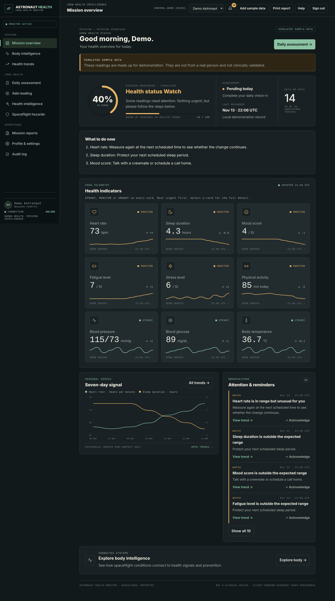
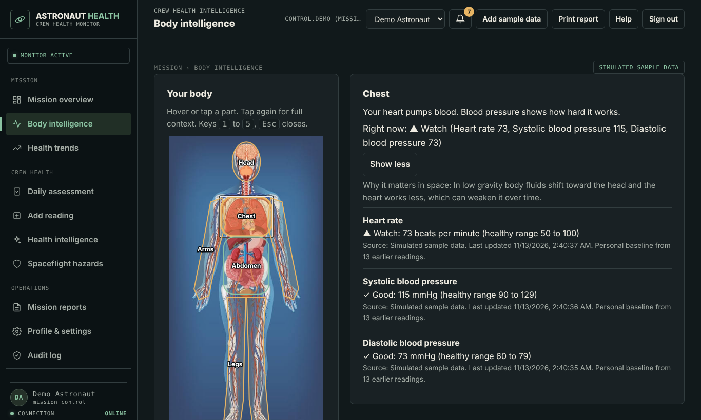
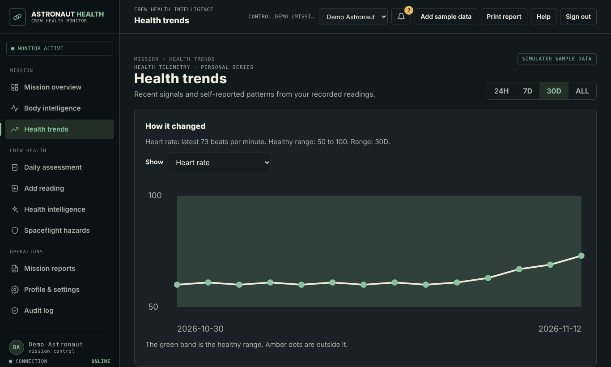

# Astronaut Health Monitor

**Autonomous health monitoring for astronauts on long-duration space missions.**

Built for the **2026 NASA Space Apps Challenge**: *Create Health Monitoring Software for Astronauts on Space Missions.*

[](https://github.com/ZainulAbideen647425/Health-Monitoring-Software-for-Astronauts-on-Space-Missions/actions)


> **Disclaimer.** This is an educational prototype built for a hackathon. It is **not a medical device** and must not be
> used for real medical decisions.



## Live demo

| | Link |
|---|---|
| **Web app** | https://astro-health-8c7r.onrender.com |
| **Android app (APK)** | https://github.com/ZainulAbideen647425/Health-Monitoring-Software-for-Astronauts-on-Space-Missions/releases/download/android-latest/astro-health.apk |

- Choose **Register** to create your own account, then press **Start with sample data** to see the dashboard filled in.
- The app runs on a free hosting plan, so the first page load after a quiet period can take up to a minute.
- This is a public demo. Do not enter real personal or medical information.
- Installing the APK: allow "install from unknown sources" when Android asks. See [docs/mobile_app.md](docs/mobile_app.md).

## The problem

On a mission to the Moon or Mars, a message to Earth can take minutes each way, and a real-time call to a doctor may be
impossible. The crew has to notice health changes in itself, understand them, and act. Spaceflight adds hazards that
are hard to feel: radiation, isolation and confinement, distance from Earth, altered gravity, and a hostile closed
environment.

## What it does

| Goal | How the software meets it |
|---|---|
| **Track vital indicators on board** | Heart rate, blood pressure, blood glucose, body temperature, sleep, mood and radiation dose, stored locally with no internet needed |
| **Spot problems early** | Documented health rules (normal, caution, critical), personal baselines and trend detection, plus ML that flags unusual days and forecasts risk |
| **Say what to do** | For every out-of-range reading: a plain explanation, likely causes, recommended actions, warning signs, and a clear "contact the flight surgeon" trigger |
| **Show it at a glance** | A dashboard with an anatomy body map, colour-and-symbol status, history charts and a ranked "what to do now" list |
| **Keep working offline** | Readings taken with no connection are queued and synchronised later, with no duplicates |
| **Protect the data** | Sign-in, three roles, tamper-evident audit log, encryption at rest |

## Screenshots

| Body map | Health trends |
|---|---|
|  |  |

## Features

**Health tracking**
- Eleven indicators (vitals, sleep, mood, fatigue, stress, activity and radiation dose) with units, "how to measure" help and "why it matters in space" explanations.
- Input validation that rejects impossible values and future timestamps.
- Several ways to enter a pulse: a Bluetooth heart rate strap or watch, a tap counter, or typing a value.
- Radiation: type in a dosimeter reading, or save a labelled estimate for the mission environment. The app keeps a
  running total against the 600 mSv career limit.
- Import many readings from a CSV file, or photograph a printed or handwritten report and review the values the app
  reads (in-browser OCR, nothing is saved until you confirm).

**Analysis**
- Rule-based status for each indicator, with sources (NASA and published clinical ranges). The rules always decide the
  safety-critical status.
- Per-astronaut Isolation Forest for unusual days and a linear-regression risk forecast. See [docs/analytics.md](docs/analytics.md).

**Dashboard**
- One offline page with four focused tabs: Today, Body, History, Add reading.
- Status is always a symbol plus a word, never colour alone.
- Interactive body map with three levels of detail and keyboard support.
- Works on phones: installable as an app (PWA) and available as an Android app.

**Security**
- Password sign-in with lockout, sessions that store only a token hash, and roles (astronaut, clinician, mission control).
- Fernet encryption of stored health data, and a hash-chained audit log. See [docs/security.md](docs/security.md).

## Architecture

```
 Browser / Android app  ──►  FastAPI  ──►  Services  ──►  Repositories  ──►  SQLite or PostgreSQL
 (single-file dashboard)     (api/)       (rules, ML,       (SQLAlchemy)
                                           guidance)
```

```
src/astronaut_health_monitor/
  api/                       HTTP endpoints and request/response shapes
  services/                  business rules, assessment, analytics, demo data
  repositories/              database access and table definitions
  domain/                    indicators, reference data, errors
  core/                      configuration, database, encryption
  offline_synchronization/   local queue that holds readings until a connection exists
  web/                       the dashboard, PWA files and bundled OCR
android/                     Android app (WebView shell with native Bluetooth)
tests/                       unit and integration tests
docs/                        documentation
```

Tech stack: Python 3.12, FastAPI, SQLAlchemy 2, Pydantic v2, scikit-learn, pandas, NumPy, vanilla JavaScript.
Details in [docs/architecture.md](docs/architecture.md).

## Quick start

Requires Python 3.12 or newer.

```bash
python -m venv .venv
source .venv/bin/activate          # Git Bash on Windows: source .venv/Scripts/activate
                                   # PowerShell: .venv\Scripts\Activate.ps1
pip install -e ".[development]"
python -m astronaut_health_monitor
```

### Try the demo

Demo mode creates simulated data and three accounts. **Never use demo mode with real data: the password is public.**

```bash
export ASTRONAUT_HEALTH_MONITOR_DEMO_MODE=true     # PowerShell: $env:ASTRONAUT_HEALTH_MONITOR_DEMO_MODE="true"  (Git Bash uses export)
python -m astronaut_health_monitor
```

Open http://127.0.0.1:8000/ and sign in with password `Demo-Passphrase-2026!` as:

| Username | Role | Can do |
|---|---|---|
| `astronaut.demo` | astronaut | see and add their own readings |
| `clinician.demo` | clinician | see and add readings for every crew member |
| `control.demo` | mission control | everything, plus users, crew, sample data and the audit log |

Ready-made test files are in [docs/sample_data](docs/sample_data/README.md).

### Real accounts

On the sign-in screen choose **Register** to create an astronaut account (password of at least 8 characters with upper
case, lower case and a special character). Turn this off with `ASTRONAUT_HEALTH_MONITOR_ALLOW_SELF_REGISTRATION=false`.

Create the first mission control account from the command line:

```bash
python -m astronaut_health_monitor.management create-user --username control.lead --role mission_control
```

## Use it on a phone

- **Hosted web app and Android app:** see [docs/hosting.md](docs/hosting.md) (Render, PostgreSQL) and
  [docs/mobile_app.md](docs/mobile_app.md) (install as an app, or build the Android APK from the `android/` folder).
- **Bluetooth heart rate sensors** work in the Android app and in Chrome. It has not yet been tested on real sensor hardware.
- Data entry options in detail: [docs/real_data_and_inputs.md](docs/real_data_and_inputs.md).

## API

Interactive documentation is served at `/docs` once the app is running.

| Method and path | Purpose |
|---|---|
| `GET /health` | Application and database status |
| `GET /health-indicators` | Explanation of every indicator |
| `POST /measurements` | Record one measurement |
| `POST /measurements/batch` | Store up to 500 queued measurements, each with its own result |
| `GET /measurements/{id}/assessment` | Status, personal baseline, trend and guidance for one reading |
| `GET /astronauts/{id}/health-summary` | Latest assessment of every indicator and an overall status |
| `GET /health-status-rules` | The ranges, critical limits and sources used for judging |

```bash
curl -X POST http://127.0.0.1:8000/measurements -H "Content-Type: application/json" -d '{
  "astronaut_id": 1, "indicator_type": "heart_rate",
  "measured_value": 64, "measured_at": "2026-11-05T08:30:00+00:00"
}'
```

## Development

```bash
pytest                 # tests, fails below 80% coverage
ruff check .           # lint
ruff format --check .  # formatting
mypy src tests         # type check
```

Continuous integration runs these checks on every push. See [CONTRIBUTING.md](CONTRIBUTING.md).

## Documentation

| Topic | File |
|---|---|
| Architecture | [docs/architecture.md](docs/architecture.md) |
| Health status rules and sources | [docs/health_status_rules.md](docs/health_status_rules.md) |
| Spaceflight hazards and context | [docs/spaceflight_context.md](docs/spaceflight_context.md) |
| Analytics and machine learning | [docs/analytics.md](docs/analytics.md) |
| Offline synchronisation | [docs/offline_synchronization.md](docs/offline_synchronization.md) |
| Security | [docs/security.md](docs/security.md) |
| Resilience | [docs/resilience.md](docs/resilience.md) |
| Real data, radiation and data entry | [docs/real_data_and_inputs.md](docs/real_data_and_inputs.md) |
| Hosting and mobile | [docs/hosting.md](docs/hosting.md), [docs/mobile_app.md](docs/mobile_app.md) |
| Demo script, pitch, submission text | [docs/release](docs/release) |

## Limitations

- A prototype, not a medical device. Ranges are from published sources and have not been clinically validated.
- No real NASA crew data is included. Readings are entered by the user or come from clearly labelled simulated data.
- The app cannot sense radiation. Doses are typed in from a dosimeter or saved as a labelled estimate.
- The tap counter and Bluetooth readings are only as accurate as the person or sensor producing them.
- There is no migration tool yet. After a schema change, recreate the local database (and keep your encryption key).

## Acknowledgements

Indicator selection follows the challenge brief and the five spaceflight hazards identified by NASA's Human Research
Program: radiation, isolation and confinement, distance from Earth, gravity fields, and hostile closed environments.

The anatomy illustration behind the body map (`src/astronaut_health_monitor/web/body_map.png`) was supplied by the
project author. Confirm its licence and add the required attribution here before publishing or submitting.

## Author

Zain, software engineering student, University of South Asia.
