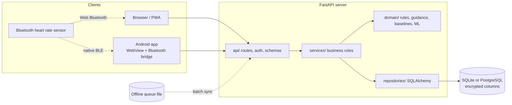
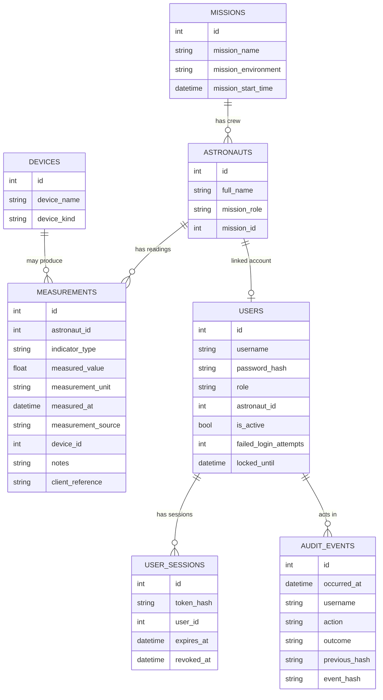
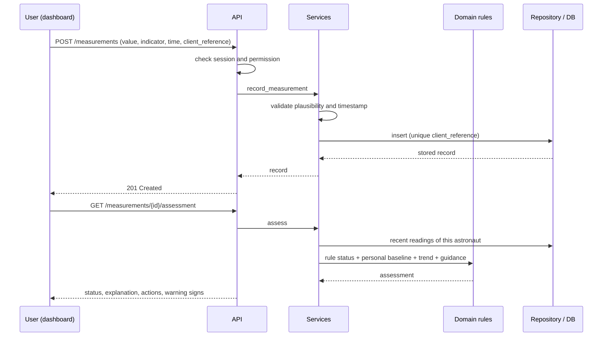
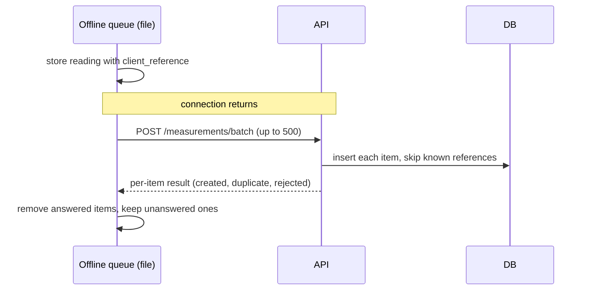
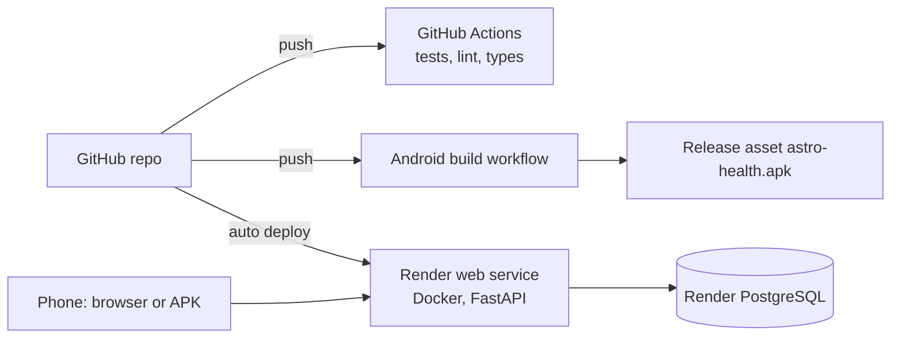

# System design

How Astronaut Health Monitor is built. Requirements are in [srs.md](srs.md); the older notes in
[architecture.md](architecture.md) record decisions phase by phase. Diagrams use Mermaid, which GitHub renders.

## 1. Overview

A FastAPI server stores health readings, judges them, and serves a single-page dashboard. The same page runs in a
browser, as an installed web app, and inside a thin Android app that opens the hosted server.

## 2. Layers

| Layer | Folder | Responsibility | Depends on |
|---|---|---|---|
| API | `api/` | HTTP routes, request and response shapes, cookies, authorization checks, error mapping | services |
| Services | `services/` | Business rules: existence checks, plausibility, idempotent recording, assessment, analytics, sign-in, audit | domain, repositories |
| Domain | `domain/` | Indicator vocabulary, status rules, guidance, personal baselines, permissions, analytics maths, exceptions | nothing |
| Repositories | `repositories/` | Table definitions and queries | core |
| Core | `core/` | Settings, database engine, encryption, password and token security | nothing |
| Offline sync | `offline_synchronization/` | Durable local queue that sends batches to `POST /measurements/batch` | API only |
| Web | `web/` | The dashboard page, service worker, manifest, icons, bundled OCR | API only |

Dependencies point downward. `domain/` has no framework or database code, so the safety rules can be tested without
a server.

## 3. Data model

Notes:
- Astronaut names, measurement values and notes are stored encrypted (Fernet) through database column types.
- `client_reference` is unique, which makes retried writes safe.
- Assessments are computed on demand and not stored, so changing a rule changes every judgement at once.
- Audit entries are hash-chained: each entry's hash covers the previous one, so edits and deletions are detected.

## 4. Key flows

### 4.1 Save a reading and get an assessment

### 4.2 Offline queue

### 4.3 Sign-in and authorization
**Roles in a real deployment:** the astronaut is the primary user. The clinician (medical review across the crew) and mission control (accounts, crew records and audit log) are an optional oversight layer. The administrator creates the clinician account; astronauts register or are given accounts. The full set-up is in [srs.md](srs.md#primary-user-and-optional-oversight).

1. `POST /auth/login` checks the password hash. Five wrong passwords lock the account for 15 minutes; wrong username and wrong password give the same error.
2. A random session token goes to the browser in an HTTP-only cookie. Only its hash is stored. Sessions end after 30 minutes idle or 8 hours total.
3. Each request resolves the cookie to a user. `domain/permissions.py` decides what that role may do (pure functions, no database). Self-registration only creates astronaut accounts; clinician and mission control accounts are created by mission control, the command line, or demo mode.
4. Every sensitive action is written to the audit log without health values.

### 4.4 Bluetooth in the Android app
The WebView has no Web Bluetooth, so `MainActivity` exposes an `AndroidBle` JavaScript bridge. It scans for the Heart
Rate service (0x180D) for 8 seconds, lets the user choose a sensor, subscribes to measurement notifications and passes
each value to the page. The page collects 15 seconds of values and saves the median. In browsers the page uses Web
Bluetooth directly.

## 5. Deployment

- Local: `python -m astronaut_health_monitor` with a SQLite file and a generated key file.
- Hosted: Docker image on Render with PostgreSQL. `DATABASE_URL` and `ENCRYPTION_KEY` are environment variables, so data and key survive restarts.
- Android: a WebView shell that opens the hosted server (address saved on the device).

## 6. Design decisions and trade-offs

| Decision | Reason | Trade-off |
|---|---|---|
| Rules decide safety status; ML only advises | Rules are documented, explainable and testable. ML needs history and can be wrong. | ML cannot raise or lower a safety status |
| Status rules are data, not code paths | Adding an indicator means adding a rule and guidance, not new logic | Rules are generic, so unusual cases need a new field |
| Judge against personal baseline as well as ranges | A slow drift is caught while values are still "normal" | Needs at least 5 earlier readings |
| Idempotent writes (`client_reference`) | Retries after a dropped connection can never duplicate data | Clients must generate stable references |
| Assessments computed on demand | No stale data and no migration when a rule changes | Slightly more work per request |
| Encryption in column types | Services and repositories stay unchanged | Encrypted values cannot be searched or sorted in SQL |
| Single-file dashboard, no build step, no external resources | Works offline, easy to audit and serve | Large file, and no browser-level automated tests yet |
| Android app as a hosted-server shell | On-device Python was not possible (no Android build of the ML dependencies for Python 3.12) | The app needs the server to be reachable |
| OCR runs in the browser | Report photos never leave the device | Larger download and lower accuracy than a cloud service |
| PostgreSQL on Render | The free web tier has no persistent disk, so SQLite would lose accounts on restart | The free database expires after about 30 days |

## 7. Security summary
Password hashes, hashed session tokens, lockout, idle and absolute session limits, role checks on every endpoint,
cross-site request blocking, security headers, Fernet encryption of sensitive fields, and a hash-chained audit log.
Limits and threat notes are in [security.md](security.md).

## 8. Known limits
- No migration tool; schema changes need a new database.
- The dashboard is not covered by browser-level automated tests; tests check that it is served, has its features and calls only existing endpoints.
- Bluetooth has not been tested against real sensor hardware.
- Device records exist but there is no endpoint to create them yet.
